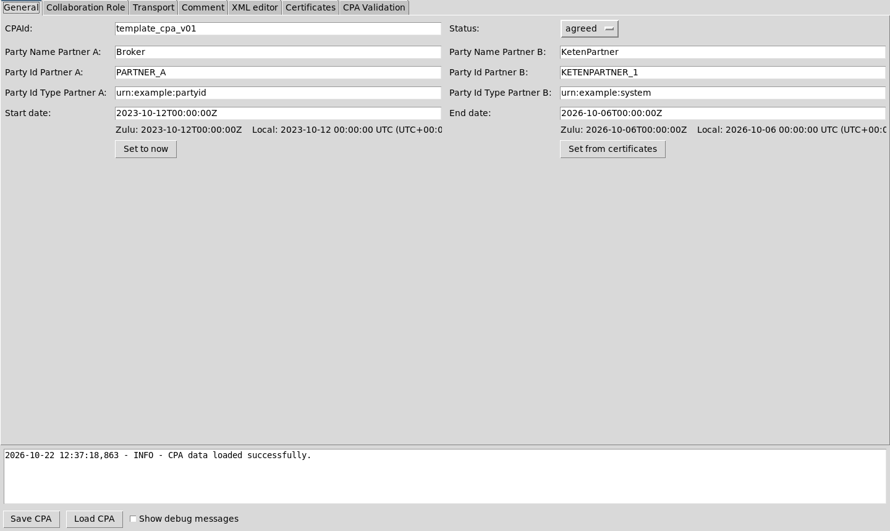
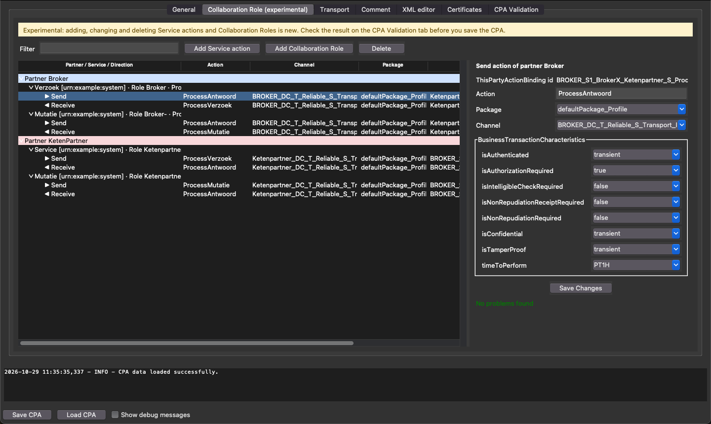
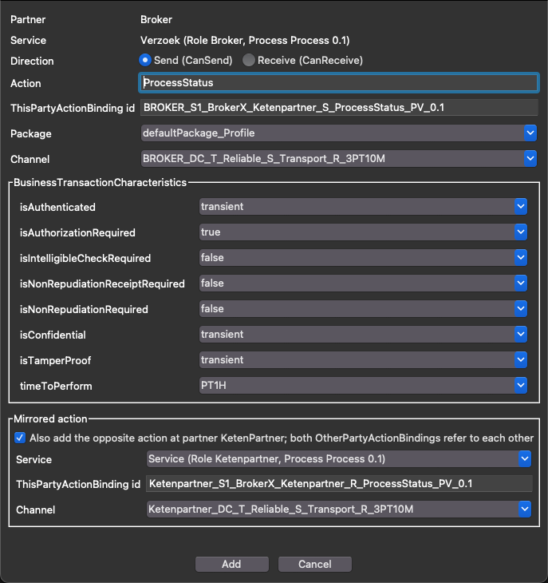
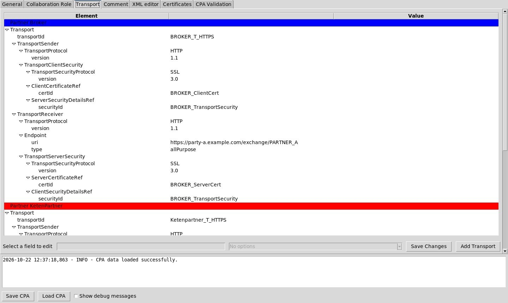
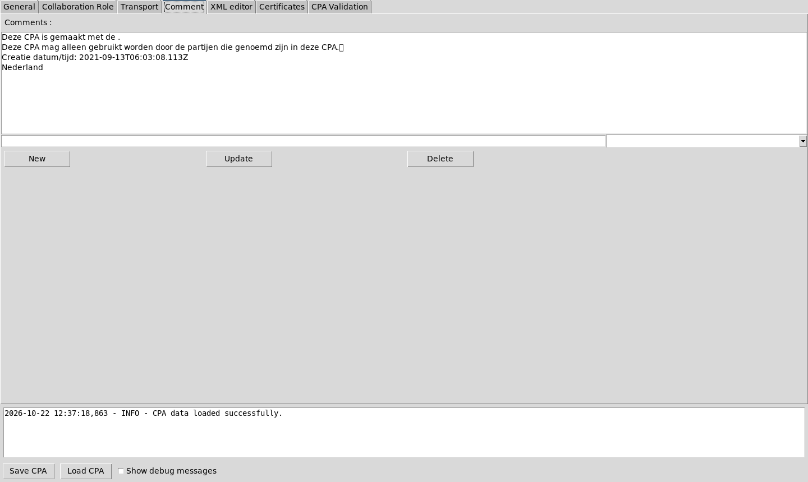
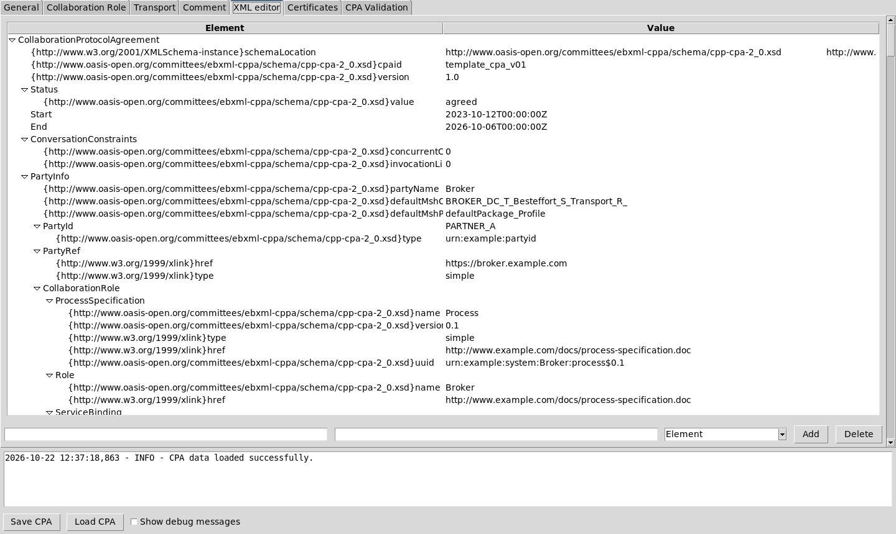
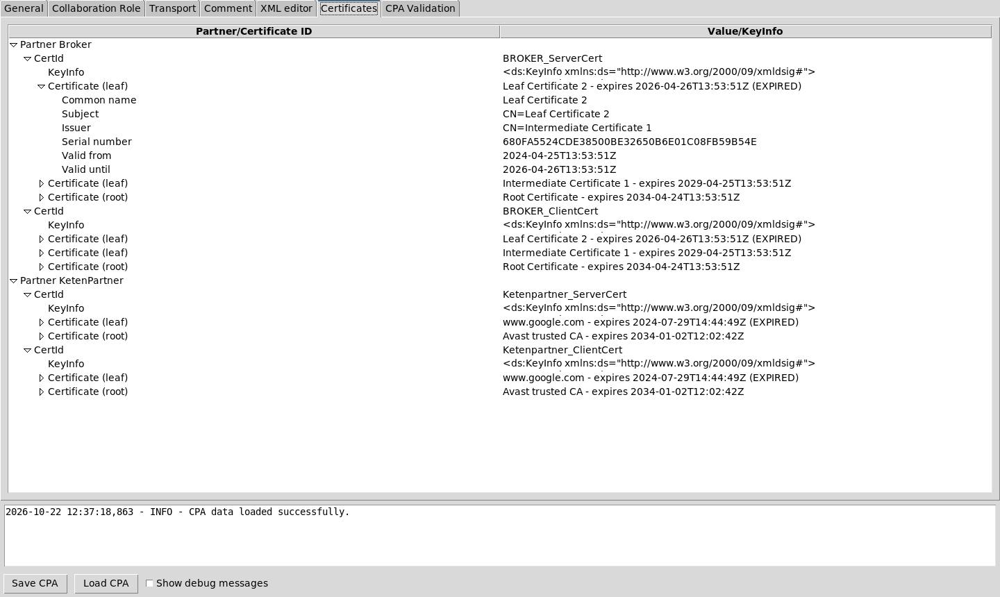
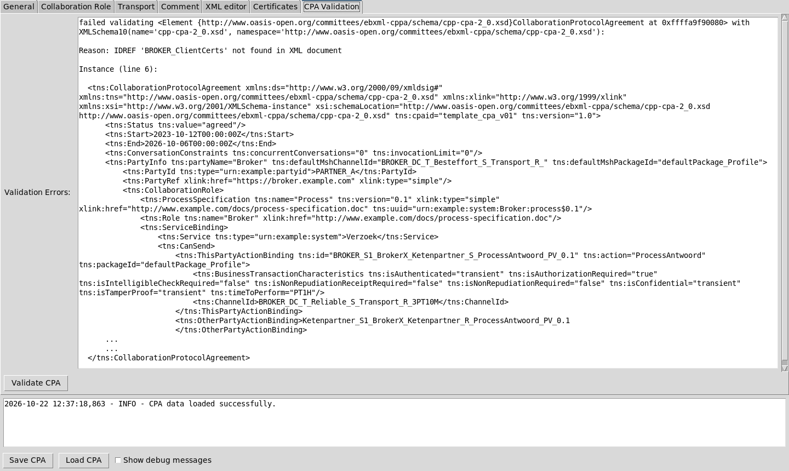

# How to use the CPA Editor

The CPA Editor opens an ebXML CPA file (Collaboration Protocol Agreement), lets you change it and saves it again as XML.

## 1. Open a CPA

- Click **Load CPA** at the bottom left of the window.
- Choose the CPA file (`.xml`).
- The log above the buttons shows `CPA data loaded successfully.` when the file is opened. An error is shown when the file cannot be read.

Loading another CPA replaces everything on screen. Changes that are not saved are lost.

## 2. Change the CPA

Each tab shows one part of the CPA. Changes are kept in memory until you save the CPA (see step 4).

A partner has the same colour on every tab: partner A light blue, partner B light red.

### General

- Shows the CPA id, status, party names, party ids, party id types, start date and end date.
- Type a new value and leave the field (press Tab or click another field). The value is applied when you leave the field.
- Choose the status from the **Status** list: `proposed`, `agreed` or `signed`.
- Dates are written as `YYYY-MM-DDTHH:MM:SSZ`, for example `2027-03-01T12:00:00Z`. The `Z` means Zulu time (UTC). In the Netherlands that is 1 hour (winter) or 2 hours (summer) earlier than the time on your clock.
- Below each date the same moment is shown twice: in Zulu time and in the timezone set on your computer. Example: `Zulu: 2026-10-09T10:44:32Z    Local: 2026-10-09 12:44:32 CEST (UTC+02:00)`. A message is shown there when the date is not valid or has no timezone.
- **Set to now** below the start date fills in the current date and time in Zulu time.
- **Set from certificates** below the end date sets the end date to the expiry date of the certificate that expires first. All certificates of both partners count: leaf, intermediate and root. The log shows which certificate determined the date. A warning is shown when that certificate has already expired.

### Collaboration Role

- The tab is called **Collaboration Role (experimental)**: adding, changing and deleting Service actions and Collaboration Roles is new. Check the result on the **CPA Validation** tab before you save the CPA.
- Shows per partner each service (one row per CollaborationRole, with service type, role and process) and below it its actions. **▶ Send** is a `CanSend`, **◀ Receive** a `CanReceive`. The columns show the action, channel, package and `OtherPartyActionBinding`.
- The column **Status** shows `OK` or the number of problems; an action with a problem is red. A problem is a channel that is not a `DeliveryChannel` of the partner, a package that is not in the CPA, or an `OtherPartyActionBinding` that is missing, does not point to the opposite action of the other partner, or is not pointed back to.
- Type in **Filter** to show only the services and actions whose name or id contains the text.
- Click an action to see it on the right. Change the action, package, channel or the `BusinessTransactionCharacteristics` and click **Save Changes**. The list under the button names the problems of the action. The id cannot be changed, so the other partner keeps referring to it.
- **Add Service action** (toolbar, or right-click a service or action) adds an action to the selected service:
  - Choose **Send** or **Receive** and type the action. The id is proposed from an action with the same direction in that service, so the naming convention of the CPA is kept; you can change it.
  - Package, channel and characteristics are filled in from the CPA; choose other values in the lists if needed.
  - **Also add the opposite action** (on by default) adds the matching action at the other partner: a Send gets a Receive and the other way round. Both `OtherPartyActionBinding` elements then refer to each other. The service of the other partner is found through the existing links, else by the same service name; choose another one in the list if needed.
  - **Add** checks that the ids are valid and not used yet. On a problem the dialog stays open with a red message.

  

- **Add Collaboration Role** adds a new service to the partner of the selected row, by default also at the other partner (with its own role name). The fields are filled in from an existing Collaboration Role; **Generate UUID** fills in the process uuid.
- **Delete** (toolbar, right-click or the Delete key) deletes the selected action or Collaboration Role after confirmation. For an action with a mirrored action, **Yes** deletes both and **No** only the selected one. A partner keeps at least one Collaboration Role.
- Changes are made in the loaded CPA; use **Save CPA** to write them to a file.

### Transport

- Shows the transport elements of both partners as a tree.
- Click a row that has a value. The label below the tree shows `Editing:` followed by the name of the field.
- Type the new value in the field below the tree. For `certId` and `securityId` you choose a value from the list instead; the list contains the ids of that partner.
- Click **Save Changes** to apply the value.

### Comment

- Shows the comments in the CPA.
- **New**: type a text in the field below the list and click **New**.
- **Update**: click a comment, change the text and click **Update**.
- **Delete**: click a comment and click **Delete**.

### XML editor

- Shows the complete CPA as a tree with elements and attributes.
- **Change a value**: select a row, double-click its **Value** column, type the new value and press Enter. Press Escape to cancel.
- **Add**: select the parent element, type the name in the first field and the value in the second field, choose **Element** or **Attribute** and click **Add**.
- **Delete**: select a row and click **Delete**.
- **Copy**: select a row, right-click it and choose **Copy Value**.

### Certificates

- Shows per partner each certificate id (`CertId`) with its `KeyInfo`.
- **See the details of a certificate**: open a `CertId` to see a **Certificate** row for every certificate of the chain, with its type (leaf, intermediate or root), common name and expiry date. Open that row for the subject, issuer, serial number, **Valid from** and **Valid until**. An expired certificate is marked with `(EXPIRED)`.
- **See which certificates are used**: a certificate that no element of the CPA refers to is shown in grey. Certificates in the normal text colour are in use.
- **Replace a certificate**: open a `CertId`, select the **KeyInfo** row, right-click it and choose **Upload Certificate**. Choose a PEM file (`.cer`, `.crt` or `.pem`). The file may contain the whole chain; put the leaf certificate first. The certificate must have an RSA key.
- **Download a certificate**: select the **KeyInfo** row, right-click it and choose **Download Certificate**. Choose a file name. The file is a PEM file with every certificate of that `CertId`, the leaf certificate first. Only certificates are saved; a CPA never contains a private key.
- **Copy**: select the **KeyInfo** row, right-click it and choose **Copy KeyInfo**.

After replacing a certificate you can use **Set from certificates** on the **General** tab to update the end date.

## 3. Validate the CPA

- Open the **CPA Validation** tab and click **Validate CPA**.
- `Geen fouten gevonden` means the CPA is valid according to the CPA schema (`cpp-cpa-2_0.xsd`).
- Otherwise the first error is shown. Fix it and validate again until no error is left.
- `Geen validatie uitgevoerd` means the loaded CPA has not been validated yet.

## 4. Save the CPA

- Click **Save CPA** at the bottom left of the window.
- To check your changes first, click **Show Changes**. A window shows the differences with the CPA as it was loaded: removed lines in red, added lines in green, with the changed words darker. Unchanged lines around a change are grey. When nothing has changed, the log says `No changes since the CPA was loaded`.
- The CPAId is proposed as file name. When the CPAId has not been changed since the CPA was loaded, a popup asks whether to save anyway: a changed CPA normally gets a new CPAId. Click **No** to stop and change the CPAId on the **General** tab, or **Yes** to save with the same CPAId.
- After clicking **Save CPA** the changes are shown first. Check them and click **Save...** to continue, or **Cancel** to stop without saving. When nothing has changed, this window is skipped.
- Choose a file name and location. Use a new name to keep the original file. The file gets the extension `.xml` when you do not type one.
- The log shows `CPA saved to` followed by the file name when the file is written. When saving fails, an error is shown and an existing file is left unchanged.

## Report a bug

- Choose **Help > Report a bug**. The browser opens a bug report on GitHub with the version and your operating system already filled in. You need a GitHub account to send it.
- Describe what you did, what you expected and what happened instead, and paste the lines of the log around the problem. Tick **Show debug messages** and repeat the steps first for more detail.
- Do not attach the CPA or paste certificates: a CPA holds data of your partners. Describe the part that matters instead, without names, party ids and addresses.

## Log and debug messages

- The log above the buttons shows what the application did and which errors occurred.
- Drag the line between the tabs and the log up to make the log larger, or down to make it smaller.
- Tick **Show debug messages** to see more detail, for example every changed field. This is off when the application starts.
- With debug messages on, **Set from certificates** also lists every certificate with its common name and end date, the first to expire at the top.

## Help

- **Help > How to use (English)** opens this guide.
- **Help > Handleiding (Nederlands)** opens this guide in Dutch.
- **Help > Readme** opens the technical readme (installation, tests, build).
- Every time the application starts, it looks up the latest version on GitHub. When a newer version exists, a popup shows both versions with the buttons **Download** and **Skip**. **Download** opens the download in your browser; **Skip** closes the popup, and it is shown again the next time you start the application. Nothing is shown when you already have the latest version or when there is no internet connection.
- **Help > Check for updates** does the same check when you ask for it and shows the result in the log. When it reports that `api.github.com` could not be found (`getaddrinfo failed`), there is no internet connection or the proxy of your network could not be used; open the release page from the message in your browser instead. On Windows the proxy settings of Windows are used automatically, so behind a company proxy the check normally just works.
- Test versions (prereleases and the nightly build) are never offered as an update. When you use one, you are offered the next normal release.
- Only the version is looked up; nothing about your CPA is sent. The application does not install anything itself: replace the old program with the downloaded one. The version you are using is shown in the title bar of the window. On Windows you can also see it without starting the program: the version is in the file name (for example `CpaEditor-1.0.2.exe`), or right-click the file, choose **Properties** and open the **Details** tab.

## Tips

- Right-click on macOS: click with two fingers or hold Control while clicking.
- Validate before you save, and keep a copy of the original CPA.
- Both partners must use exactly the same CPA. Send the saved file to the other party after a change.
